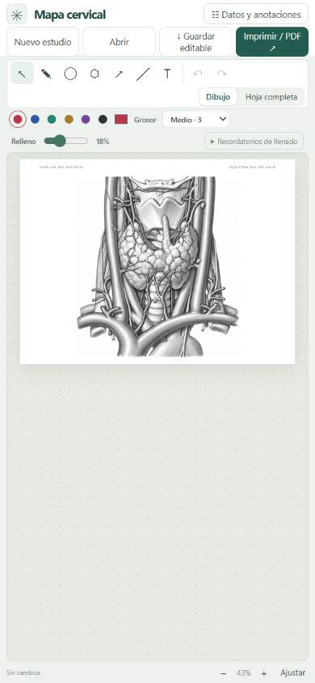

# Mapa cervical

[English](README.md) · **Español**

**Un esquema anatómico que puedes anotar, editar y llevar a una hoja A4.**

Prototipo de editor gráfico para documentar hallazgos cervicales sobre un esquema anatómico. Permite trabajar con dibujos, texto y flechas, conservar un archivo editable y preparar una salida para impresión.

[Explorar el editor](https://mapa-cervical-salvador.pablo-aguirre.chatgpt.site)

*Captura del navegador a tamaño móvil; no sustituye una prueba en un teléfono físico.*

## El problema

Los esquemas en papel permiten comunicar la localización de un hallazgo, pero corregir una anotación o retomar un estudio puede exigir rehacer parte del documento. El proyecto explora cómo conservar esa forma de representación y hacer editables sus elementos.

## Qué permite hacer

- Dibujar trazos libres, elipses, contornos y líneas.
- Añadir texto y flechas sobre el esquema.
- Seleccionar, mover, redimensionar y girar los dibujos.
- Ajustar colores, grosor y transparencia.
- Deshacer y rehacer cambios.
- Guardar y volver a abrir un estudio editable.
- Preparar una hoja A4 para imprimir o guardar como PDF desde el navegador.

## Estado y alcance

Prototipo funcional de documentación gráfica. Las anotaciones las realiza el usuario: el editor no interpreta imágenes ni calcula una etapificación automáticamente. Su uso dentro de un flujo clínico está pendiente de validación.

## Mi aporte

**Dr. Pablo Aguirre Araya, médico general de zona en Arica.** Identificación de la necesidad, definición del flujo de anotación y decisiones de diseño, con desarrollo iterativo apoyado por IA.

## Guardado y datos

El editor utiliza el almacenamiento local del navegador para recuperar el trabajo y permite descargar una copia editable. El almacenamiento local puede perderse al borrar los datos del navegador; conviene conservar la copia descargada.

Para explorar esta demo, utiliza ejemplos ficticios sin identificadores de pacientes. El alojamiento de la demo no constituye un sistema institucional de historia clínica ni un repositorio de estudios.

## Tecnología

HTML, CSS y JavaScript, con elementos SVG para las anotaciones. La impresión utiliza las opciones del navegador.

## Próximos pasos

- Observar el uso por profesionales y revisar la claridad de las herramientas.
- Evaluar la legibilidad del documento impreso y la recuperación de estudios.
- Revisar la procedencia y los permisos del material anatómico antes de distribuir un paquete de código y recursos.

[Abrir la demo](https://mapa-cervical-salvador.pablo-aguirre.chatgpt.site) · [Contacto](mailto:pablo.aguirre.araya@gmail.com)
