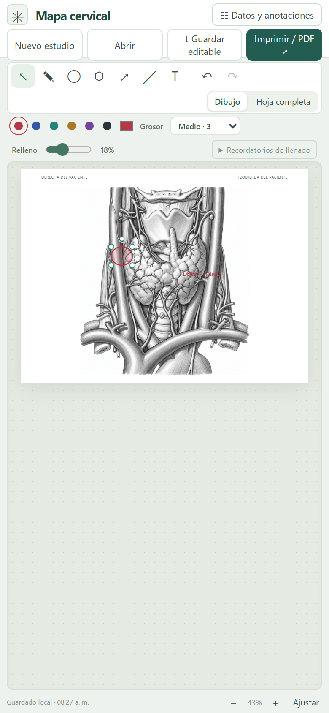
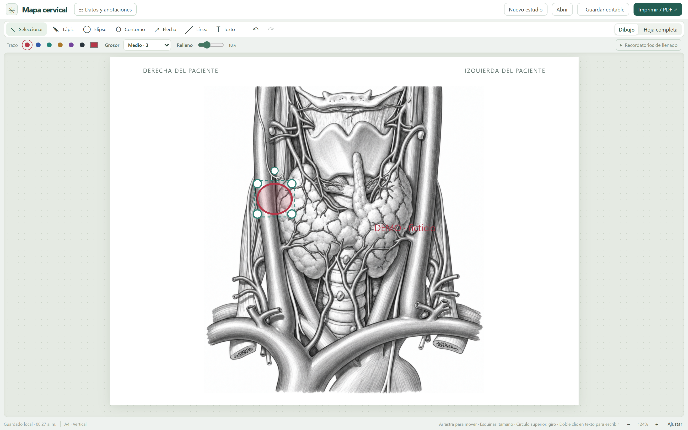
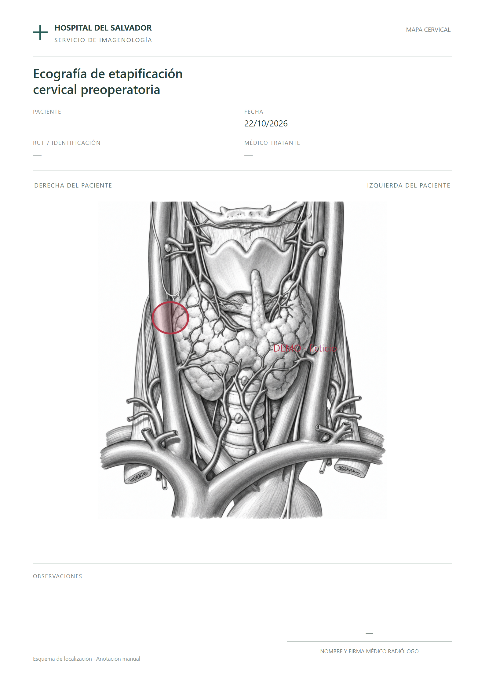

# Mapa cervical

**English** · [Leer en español](README.es.md)

**Annotate a neck diagram. Edit the marks. Prepare an A4 page.**

A graphical documentation prototype for keeping drawings, text and arrows editable instead of redrawing a paper diagram.

[Explore the editor](https://mapa-cervical-salvador.pablo-aguirre.chatgpt.site) · [Contact](mailto:pablo.aguirre.araya@gmail.com)

**Working prototype.** Manual annotation only; no automatic interpretation, diagnosis or clinical staging. Clinical workflow evaluation remains pending.

*Real 390 × 844 mobile capture. Fictional marks; no patient identifiers. Spanish interface.*

## Annotation and editing

- Freehand drawing, ellipses, contours, lines, text and arrows.
- Select, move, resize and rotate elements; change color, stroke and fill.
- Undo and redo, save an editable study and reopen it.
- Prepare an A4 output for browser printing or PDF export.

## From editing to print

*Actual browser print rendering. “DEMO · ficticio” is a manually entered demonstration label, not a clinical finding. [Full-page editor view](assets/desktop-print-layout.webp).*

## Scope, storage and assets

The user supplies every annotation. Browser storage can recover work, and a downloaded editable copy can be reopened. Clearing site data can remove the local copy. This public demo is not a patient record system; use fictional examples without identifiers.

Institutional wording visible in the existing template does not establish institutional endorsement. Provenance and redistribution permissions for anatomical assets still need review before a source-and-assets package is released. This repository contains the presentation only.

HTML, CSS and JavaScript, with SVG annotations and the browser's printing tools.

## My contribution and next steps

Need definition, annotation workflow and interface decisions, with AI-assisted development. **Pablo Aguirre Araya, physician in Chile.** Next: observe professional use, evaluate print legibility and study recovery, and review asset permissions.

[Open the demo](https://mapa-cervical-salvador.pablo-aguirre.chatgpt.site) · [Capture details](docs/screenshots.md)
